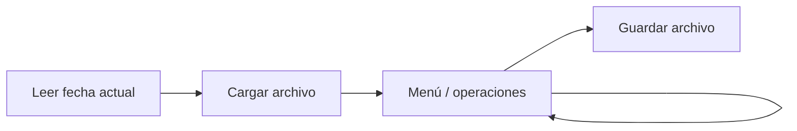
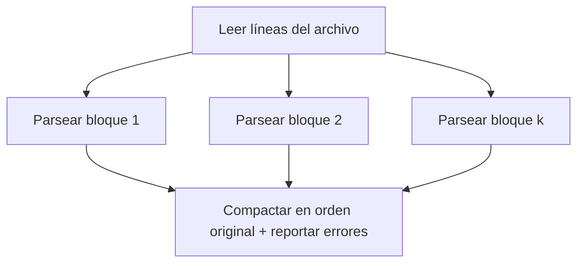
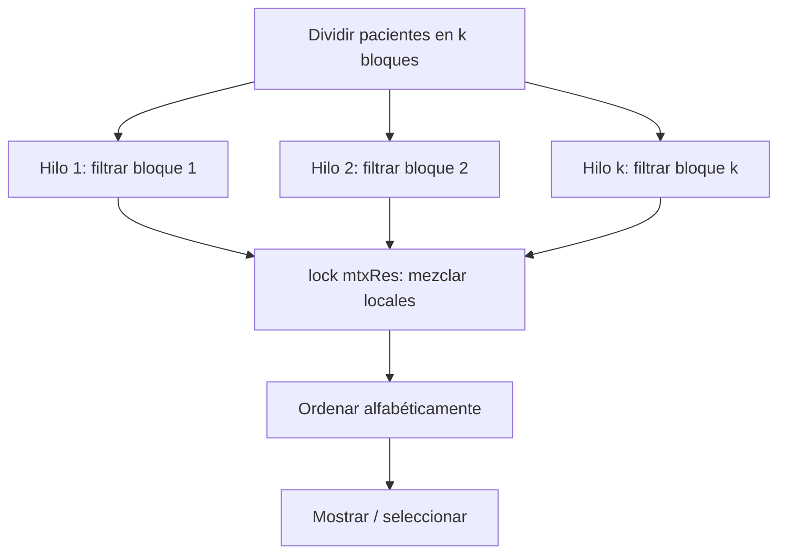
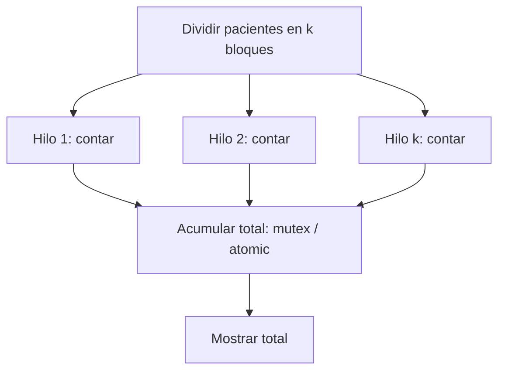
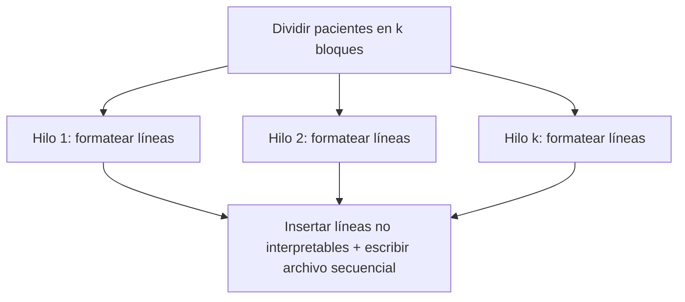
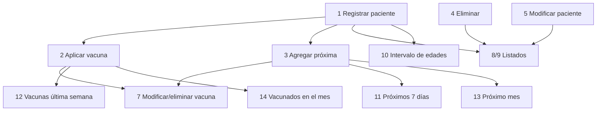

# Práctica 4 – Grafos de dependencia y bloques COBEGIN–COEND

Compilar: `g++ -std=c++17 -O2 -pthread practica4.cpp -o practica4`

Recursos compartidos y su protección:

| Recurso | Acceso concurrente | Protección |
|---|---|---|
| `pacientes` (vector) durante búsquedas | Solo lectura por varios hilos | No requiere exclusión: los datos no se modifican mientras hay hilos activos (todas las modificaciones ocurren en el hilo principal, después del `join`) |
| Vector de resultados `res` | Escritura de varios hilos | `mutex mtxRes` + `lock_guard` |
| `total`, `porVac` (op. 12) | Acumulación de varios hilos | `mutex mtxRes` + `lock_guard` (reducción local → global) |
| `total` (op. 13) | Acumulación de varios hilos | `atomic<int>` |
| `errores` (carga) | Escritura de varios hilos | `mutex mtxRes` + `unique_lock` |
| `tmp[i]`, `ok[i]`, `lineas[i]` (carga/guardado) | Cada hilo escribe posiciones distintas | Sin exclusión (particionado disjunto) |

---

## 1. Flujo general del programa

```
S0: leer fecha actual
S1: cargar archivo (concurrente, ver §2)
S2: ciclo de menú (secuencial, interacción con el usuario)
      └─ cada operación de búsqueda/consulta usa §3, §4 o §5
S3: guardar archivo (concurrente, ver §6)
```



---

## 2. Carga del archivo (`cargar`)

Grafo de dependencia:



Bloque concurrente:

```
S1: leer todas las líneas a  lineas[0..n-1]
COBEGIN
    Hilo_1: for i in [0, n/k)         parsear(lineas[i]) -> tmp[i], ok[i]
    Hilo_2: for i in [n/k, 2n/k)      parsear(lineas[i]) -> tmp[i], ok[i]
    ...
    Hilo_k: for i in [(k-1)n/k, n)    parsear(lineas[i]) -> tmp[i], ok[i]
COEND
S3: recorrer tmp en orden y construir 'pacientes' (conserva orden original)
```

Los hilos escriben posiciones distintas (sin condición de carrera); los errores se agregan con `unique_lock(mtxRes)`.

---

## 3. Búsqueda paralela genérica (`buscarIdx`)

Usada en las operaciones **2, 3, 4, 5, 6, 7** (buscar paciente), **8, 9** (listar), **10, 11, 14** (filtros) y en validación de duplicados (op. 1).



```
S0: dividir [0,N) en k bloques
COBEGIN
    Hilo_j (j=1..k):
        loc = {}
        for i in bloque_j: if pred(pacientes[i]) loc.push(i)
        lock_guard(mtxRes);  res.insert(loc);     // sección crítica corta
COEND
S2: ordenar(res)  por nombre (sin acentos/mayúsculas)
S3: mostrar resultados
```

---

## 4. Conteos paralelos (operaciones 12 y 13)



```
S0: lo = hoy - 7 (op.12)  |  lo = hoy, hi = hoy + 1 mes (op.13)
COBEGIN
    Hilo_j: loc = contar dosis en rango dentro de su bloque
            // op.12: lock_guard(mtxRes); total += loc; porVac += mapa_local
            // op.13: total += loc           (atomic<int>)
COEND
S2: imprimir total
```

---

## 5. Operaciones de modificación (1–7)

Se ejecutan en el hilo principal porque dependen de la entrada del usuario y modifican `pacientes`. La **parte de búsqueda** sí es concurrente (§3).


Dependencia: `Leer → Buscar → Seleccionar → Validar → Modificar` (cadena estrictamente secuencial; la modificación no puede iniciarse antes de terminar la búsqueda).

---

## 6. Guardado (`guardar`)



```
COBEGIN
    Hilo_j: for i in bloque_j: lineas[i] = formatearLinea(pacientes[i])
COEND
S2: insertar líneas inválidas conservadas
S3: escribir lineas[] en el archivo (orden original; nuevos al final)
```

---

## 7. Dependencias entre operaciones del menú



Las operaciones de consulta (8–14) no dependen entre sí y podrían ejecutarse simultáneamente (todas son de solo lectura); las de modificación (1–5, 7) se serializan por naturaleza al ser interactivas.

---

## 8. Notas de formato del archivo

```
Nombre, Apellido1, Apellido2; dd/mm/aaaa; vacuna, fecha, vacuna, fecha; vacuna, fecha.
```

- Una línea por paciente. Sección de aplicadas o próximas vacía → `; .` / `; ;`.
- Los datos NO se normalizan: se conservan tal como están en el archivo (mayúsculas, acentos, espacios). Búsquedas, comparaciones y validación de vacunas ignoran mayúsculas y acentos. Los pacientes sin cambios se reescriben idénticos.
- Las líneas con formato inválido se conservan sin cambios al guardar.